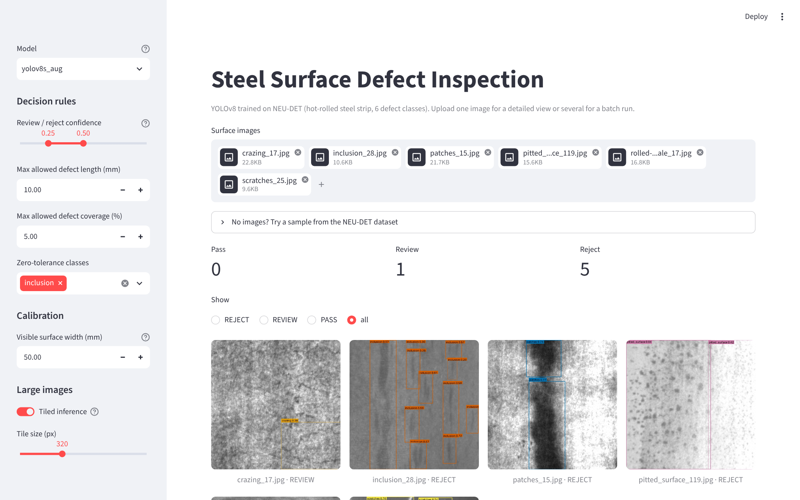
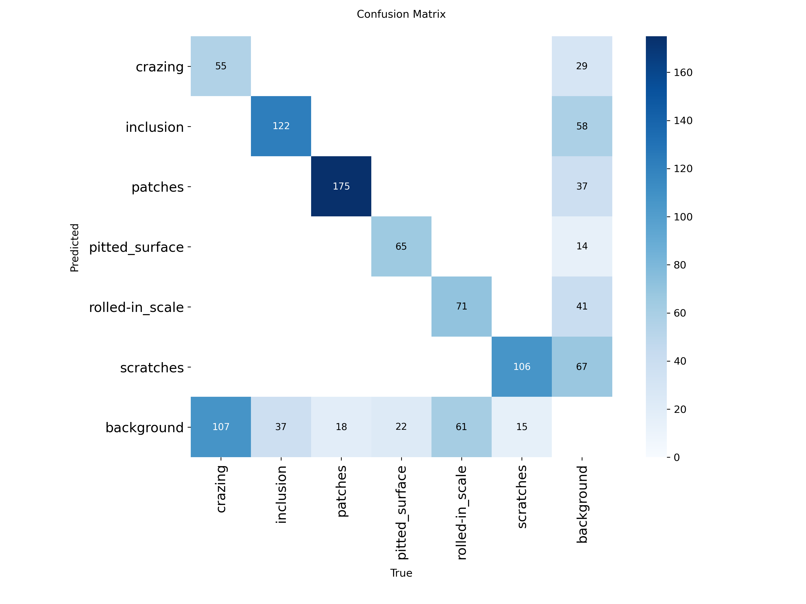
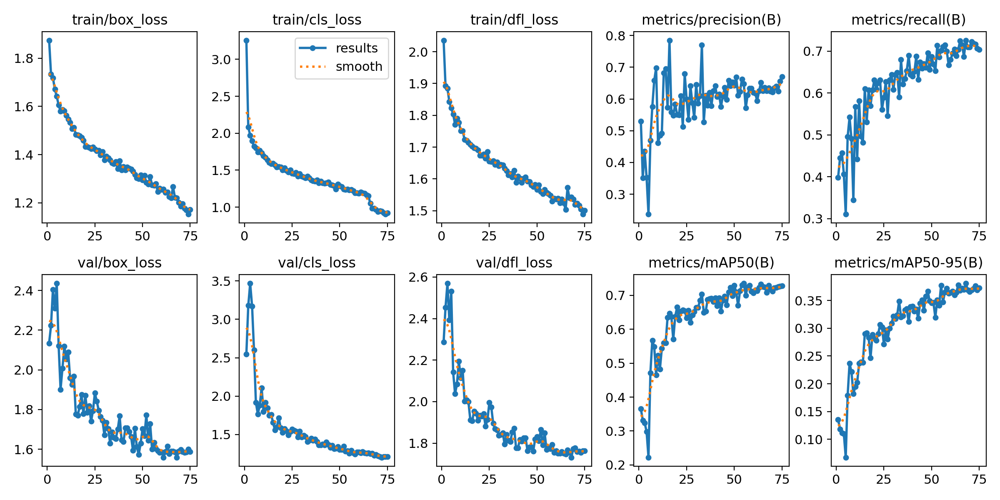
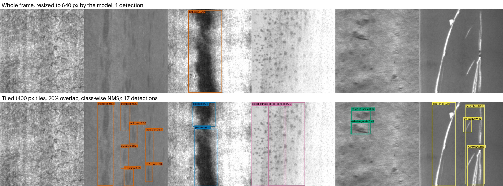

# Steel Surface Defect Inspection

A YOLOv8 detector for surface defects on hot-rolled steel strip, wrapped in a small inspection tool: it finds defects, converts them to millimetres, and turns the detections into a PASS / REVIEW / REJECT decision based on rules a quality engineer can set.

Trained on the NEU surface defect dataset (NEU-DET): 1,800 grayscale images, 200×200 px, six defect classes, 300 images each.

**Try it online:** [surface-detect-ai.streamlit.app](https://surface-detect-ai.streamlit.app/) (free Streamlit Community Cloud; runs on a CPU, and if nobody has used it for a while it sleeps and takes about a minute to wake up).



## What it does

- **Detection** of six defect types: crazing, inclusion, patches, pitted surface, rolled-in scale, scratches.
- **Measurement.** Given the real width of the surface in view, each box is converted to length, width and area in mm. Total defect coverage is computed from the union of the boxes, so overlapping boxes are not counted twice.
- **Decision rules.** Instead of rejecting on any detection, a part is rejected only if a confident detection breaks a rule (too long, too much coverage, or a zero-tolerance class). Low-confidence detections go to manual review.
- **Batch mode.** Drop a folder's worth of images in, get pass/review/reject counts and a filterable gallery. Everything is logged and can be exported as CSV.
- **Tiled inference** for frames much larger than the 200 px training crops (see below).
- **Model comparison**: the baseline and the final model side by side on the same image.
- **Sample browser.** All 360 NEU-DET validation images (60 per class) ship with the repo. Pick any one by class and number, take a random one, or run a whole class as a batch. The annotator's boxes are drawn next to the model's prediction, with a count of how many annotated defects the model found (same class, IoU ≥ 0.5).
- A **command-line** version (`scripts/inspect_folder.py`) that runs the same pipeline without the UI.

## Training

I trained two models on Google Colab. The configs in `configs/` contain the exact hyperparameters, taken from the checkpoint files.

| | Baseline | Final |
|---|---|---|
| Architecture | YOLOv8n | YOLOv8s |
| Parameters | 3.0 M | 11.1 M |
| Epochs | 25 | 75 (early-stop patience 20) |
| Extra augmentation | none (defaults) | ±15° rotation, vertical flip 0.3, less scale jitter |
| Training time | 10 min | 36 min |

The reasoning behind the augmentation changes: a defect on a steel strip has no natural "up", so rotations and vertical flips don't change the label. All NEU crops are taken at the same magnification, so I reduced scale jitter.

## Results

Validation metrics at the best epoch of each run:

| | Precision | Recall | mAP50 | mAP50-95 |
|---|---|---|---|---|
| YOLOv8n baseline | 0.675 | 0.700 | **0.736** | 0.380 |
| YOLOv8s + augmentation | 0.635 | **0.726** | 0.730 | **0.381** |

**The bigger model did not do better.** With 3.7× the parameters and 3× the epochs, mAP stayed the same. Recall went up 2.6 points and precision dropped 4 points. That is a shift along the same precision/recall curve, not a better model. (The two runs used different exports of the dataset, so the validation splits may not be identical. `scripts/evaluate.py` re-evaluates both on one split.)

The flat result tells me the limit is not model capacity. The confusion matrix of the final model shows where it actually is:



| Class | Val instances | Found | Recall | Background predicted as this class |
|---|---|---|---|---|
| patches | 193 | 175 | 91 % | 37 |
| scratches | 121 | 106 | 88 % | 67 |
| inclusion | 159 | 122 | 77 % | 58 |
| pitted_surface | 87 | 65 | 75 % | 14 |
| rolled-in_scale | 132 | 71 | 54 % | 61 |
| crazing | 162 | 55 | **34 %** | 29 |

Two things stand out:

1. **The model never confuses one defect class with another.** Every off-diagonal entry between real classes is zero. All of the errors are against "background": a defect that was missed, or a box where no label exists. The classifier part works. The problem is deciding *where a defect starts and ends*.
2. **Crazing is the weak class, with only one in three found.** Crazing is a fine network of cracks spread over the whole surface, more of a texture than an object. In NEU the annotators boxed it inconsistently: sometimes one box over the whole image, sometimes several small ones. A detector can't learn a consistent boundary from inconsistent boxes. Rolled-in scale has a milder version of the same problem.

Many of the "false positives" also look like real defects that weren't labelled when I check them by eye (scratches are often annotated as one long box in one image and several short ones in another). So part of the measured precision is label noise, not model error.

If I continue this project, the next step is to fix the data, not to use a bigger model: re-label crazing consistently, or treat crazing as an image-level classification problem and keep detection for the classes that are actual objects.



## From detections to a decision

The first version of the app rejected a part as soon as the model drew any box. On a real line that would be useless. Every NEU image contains a defect, but in production most of what a camera sees is acceptable, and a tiny cosmetic mark shouldn't stop a coil. The decision logic is now in `inspector/rules.py`:

```
REJECT  if any confirmed detection (conf ≥ reject threshold)
          - belongs to a zero-tolerance class, or
          - is longer than the max allowed length, or
        if confirmed defects cover more than the max allowed % of the surface
REVIEW  if anything was detected above the review threshold but no rule was broken
PASS    otherwise
```

The gap between the review and reject thresholds is the main thing an operator would tune: it sets how many images a person has to look at in exchange for fewer wrong automatic decisions. All thresholds are adjustable in the sidebar, and the rules are unit tested (`tests/test_rules.py`).

Measurements use one mm/px scale for the whole frame, from the visible surface width. That assumes a camera looking straight down with little lens distortion. Lengths are bounding-box lengths, so a diagonal scratch is underestimated. That's fine for pass/fail but not for precise measurement.

## Tiled inference for full-size frames

The model was trained on 200 px crops. A line-scan camera produces frames thousands of pixels wide. If you give one of those to the model directly, it gets shrunk to 640 px and most defects become a few pixels wide.

`inspector/inference.py` cuts large frames into overlapping tiles, runs them as one batch, moves the boxes back into frame coordinates and removes duplicates from the overlap regions with class-wise NMS.

To test it I put the six sample images next to each other and upscaled them 2× to make a 2400×400 "frame":



Without tiling, the model finds one defect and gets its class wrong (it calls the patch an inclusion). With tiling, it finds defects in five of the six regions with the right classes. Crazing is still missed, which matches its low recall above.

## Speed

CPU latency per 640 px image, end to end (pre-processing, model, NMS), median of 30 runs on a 2-vCPU Intel Xeon @ 2.1 GHz:

| Model | PyTorch | ONNX Runtime |
|---|---|---|
| YOLOv8n baseline | 90 ms | 52 ms |
| YOLOv8s final | 269 ms | 137 ms |

Exporting to ONNX roughly halves latency at no accuracy cost. Since the larger model isn't more accurate, **the YOLOv8n model is the better choice for deployment**: 52 ms with ONNX against 269 ms for YOLOv8s in PyTorch, at the same mAP. I kept YOLOv8s as the default in the app only because its higher recall suits a setting where every detection gets a second look anyway. Run `python scripts/benchmark.py` to reproduce these numbers.

## Running it

```bash
git clone https://github.com/Warriorlie123/surface-detect-ai.git
cd surface-detect-ai
pip install -r requirements.txt
streamlit run app.py
```

Command line, no UI:

```bash
python scripts/inspect_folder.py sample_images --field-mm 50 --out report.csv
```

Retraining from scratch:

```bash
# NEU-DET from Kaggle or the original site, any folder layout
python scripts/prepare_neu_det.py --src path/to/NEU-DET --out data/neu_yolo
python scripts/train.py --config configs/yolov8s_aug.yaml --data data/neu_yolo/data.yaml
python scripts/evaluate.py --data data/neu_yolo/data.yaml
```

Tests: `pip install -r requirements-dev.txt && pytest`

## Layout

```
app.py                  Streamlit UI
inspector/
  inference.py          model loading, tiled prediction, NMS merge
  measure.py            px -> mm, union-based coverage
  rules.py              PASS / REVIEW / REJECT logic
  draw.py               box rendering
  groundtruth.py        annotator boxes for the samples, prediction vs. annotation matching
scripts/
  prepare_neu_det.py    VOC XML -> YOLO format, stratified split
  train.py              training from a config file
  evaluate.py           per-class AP for several models on one split
  benchmark.py          PyTorch vs ONNX latency
  inspect_folder.py     batch inspection from the command line
  build_sample_library.py  copies a NEU-DET split into sample_images/neu_det/ for the app
sample_images/          six quick picks + neu_det/ (360 validation images and labels.json)
configs/                hyperparameters of both runs
weights/                trained models
tests/                  unit tests (measurement, rules, tiling, data conversion)
```

## Limitations

- NEU-DET is small and every image contains a defect, so the model has never seen a clean surface. On a real line, the false-positive rate on good material is the number that matters most, and this dataset can't measure it.
- All images come from one source under the same lighting. I'd expect accuracy to drop on images from a different camera or line.
- The six quick-pick images in `sample_images/` may be from the training set, so they show how the app works, not how accurate it is. The 360 images in `sample_images/neu_det/` are the validation split: their box counts per class match the validation column of the table above exactly, so they are the images the final model was validated on, not trained on. Validation was used to pick the best epoch, so they are not a fully independent test set. The baseline was trained on a different export and may have seen some of them.
- The default calibration (50 mm field of view) and rule thresholds are placeholders. NEU doesn't publish the physical scale of its images.

## Acknowledgements

Dataset: K. Song and Y. Yan, "A noise robust method based on completed local binary patterns for hot-rolled steel strip surface defects," *Applied Surface Science*, 2013; bounding-box annotations from Y. He et al., "An end-to-end steel surface defect detection approach via fusing multiple hierarchical features," *IEEE Transactions on Instrumentation and Measurement*, 2020. Detector: [Ultralytics YOLOv8](https://github.com/ultralytics/ultralytics).

## License

AGPL-3.0, the same license as Ultralytics, which this project and its trained weights are built on.
